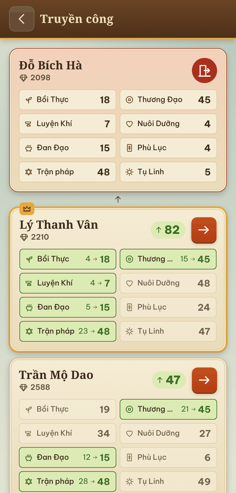
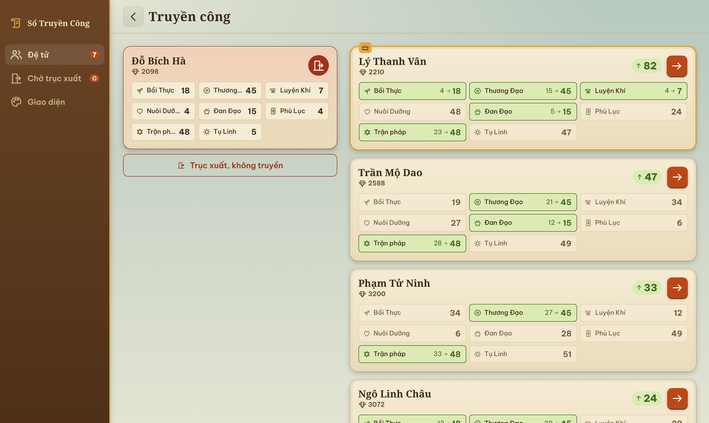

# Sổ Truyền Công

Công cụ hỗ trợ game "Ta làm tông sư trong tiên môn": chọn đệ tử cần trục xuất, xem nên truyền công cho ai để tăng nhiều cấp nhất.

**https://kokoroou.github.io/tongsu-calc/**

<p align="center">
  
  
</p>

Dữ liệu lưu trong trình duyệt, có thể sao lưu ra file JSON. Không cần build: mở `index.html` hoặc `npx serve .`

```bash
npm test
```

[MIT](LICENSE)
